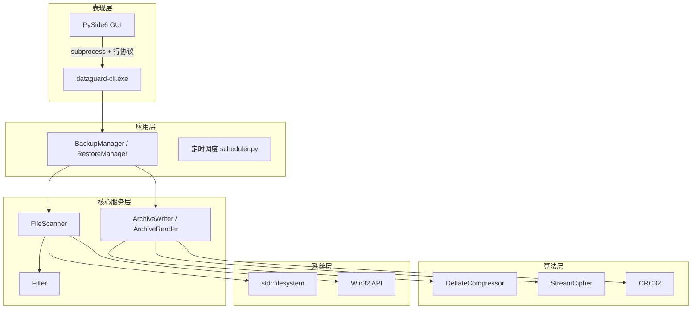
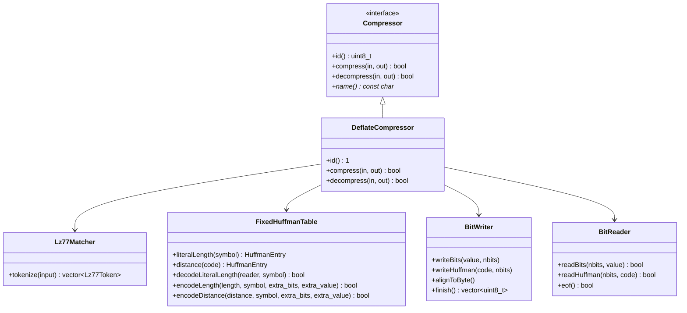

# DataGuard 系统设计文档

> 版本：v0.1（骨架与基础模块）｜最后更新：2026-10-18
> 本文档按版本递增补充，v1.0 定稿。UML 图使用 Mermaid，可在 GitHub / VS Code / mermaid.live 直接渲染；如需 StarUML 工程文件，可按同名结构复刻。

## 1. 系统架构

## 2. 实现决策记录（v0.1 确认）

| 功能 | 决策 | 理由 | 分数影响 |
|---|---|---|---|
| 打包解包 | 自研 BKPK v1 容器格式 | 备份功能本身需要自定义存储格式，自研无额外成本 | 满分 10 |
| 压缩解压 | 自研 DEFLATE（LZ77 + 固定 Huffman，RFC 1951 子集） | 用户明确要求 DEFLATE；LZ77+Huffman 是课程技术亮点 | 满分 10 |
| 加密解密 | 自研流密码（KSA/PRGA + 随机 IV） | 禁止简单异或；实现正确性可由自检用例保证 | 满分 10 |
| 图形界面 | Python 3.11 + PySide6 | 本机无 Qt C++ 环境；README 允许脚本语言写界面 | 满分 10 |
| 定时调度 | Python 端实现（守护线程 + tasks.json） | 与 GUI 同进程，避免 C++ 依赖 Qt 定时器 | 满分 10 |

## 3. DEFLATE 类族设计（v0.3 实现）

职责划分：
- `Lz77Matcher`：32KB 滑窗 + 3 字节哈希链，输出 literal / (length, distance) token 序列；
- `FixedHuffmanTable`：RFC 1951 固定码表，负责码字查询、长度/距离码与值的映射、符号解码；
- `BitWriter` / `BitReader`：位级读写，普通数据 LSB-first、Huffman 码 MSB-first；
- `DeflateCompressor`：编排上述三类，完成压缩/解压。

## 4. 版本计划

| 版本 | 内容 |
|---|---|
| v0.1（10-18） | 工程骨架、CRC32、路径工具、筛选器、扫描器、Windows 元数据、单元测试 |
| v0.2（10-19） | BKPK 档案格式、BackupManager/RestoreManager、CLI 行协议 |
| v0.3（10-20） | DEFLATE 压缩实现并接入档案流水线、11 个算法自检用例 |
| v0.4（10-21） | 流密码加密、六类筛选完善、特殊文件与元数据还原、retention 淘汰 |
| v0.5（10-21） | PySide6 界面、定时调度与任务持久化 |
| v1.0（10-21） | 需求/设计/测试报告定稿、全量回归、发布 |

## 5. v0.1 模块说明

| 模块 | 文件 | 职责 |
|---|---|---|
| FileEntry | include/dataguard/file_entry.h | 统一的文件条目数据结构（路径/类型/大小/时间/属性/属主/链接信息） |
| path_utils | src/core/path_utils.cpp | glob 匹配、UTF-8 与 path 互转、ASCII 小写化 |
| crc32 | src/archive/crc32.cpp | CRC-32（0xEDB88320 查表法），用于档案完整性校验 |
| Filter | src/core/filter.cpp | 六类筛选规则（路径/扩展名/文件名/时间/尺寸/属主），exclude 优先 |
| FileScanner | src/core/scanner.cpp | 递归扫描目录树，目录先于文件输出，符号链接不跟随 |
| win_metadata | src/win/win_metadata.cpp | Win32 读取时间/属性/属主/硬链接计数/文件 ID；还原时写回元数据 |
