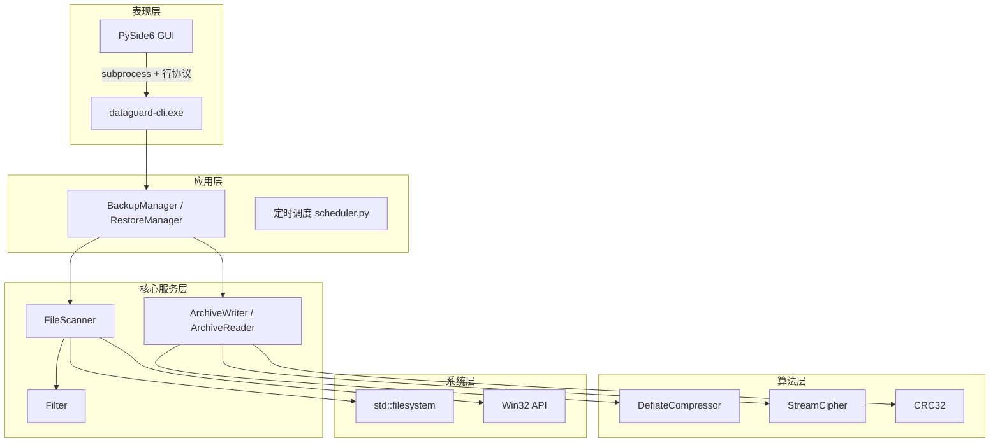
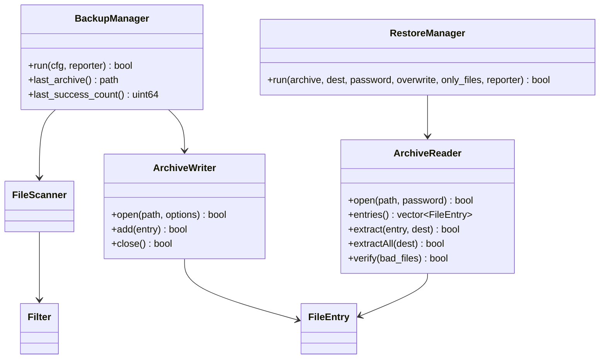
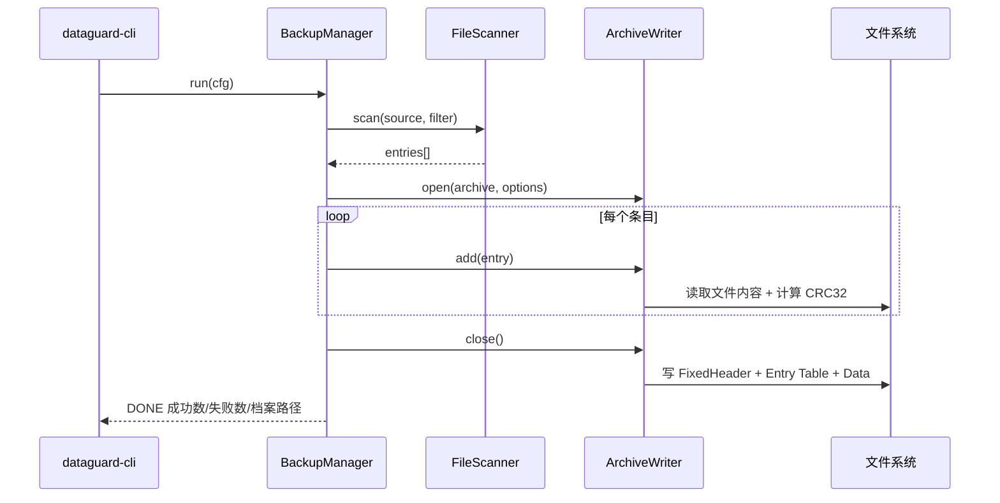
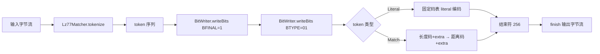
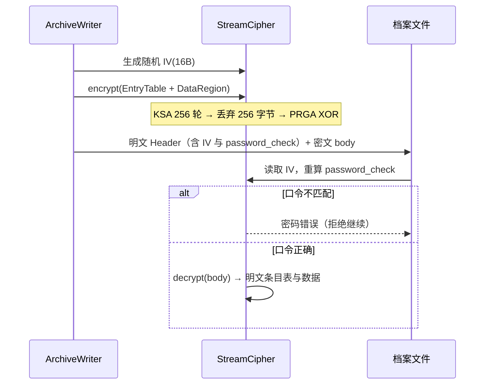
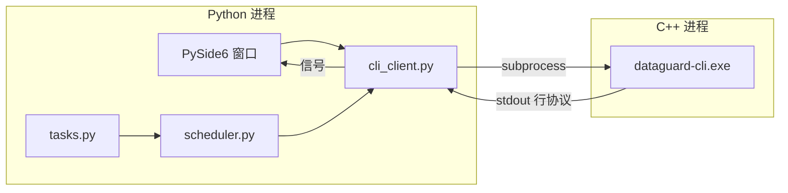

# DataGuard 系统设计文档

> 版本：v0.1（骨架与基础模块）｜最后更新：2026-10-18
> 本文档按版本递增补充，v1.0 定稿。UML 图使用 Mermaid，可在 GitHub / VS Code / mermaid.live 直接渲染；如需 StarUML 工程文件，可按同名结构复刻。

## 1. 系统架构



## 2. 实现决策记录（v0.1 确认）

| 功能 | 决策 | 理由 | 分数影响 |
|---|---|---|---|
| 打包解包 | 自研 BKPK v1 容器格式 | 备份功能本身需要自定义存储格式，自研无额外成本 | 满分 10 |
| 压缩解压 | 自研 DEFLATE（LZ77 + 固定 Huffman，RFC 1951 子集） | 用户明确要求 DEFLATE；LZ77+Huffman 是课程技术亮点 | 满分 10 |
| 加密解密 | 自研流密码（KSA/PRGA + 随机 IV） | 禁止简单异或；实现正确性可由自检用例保证 | 满分 10 |
| 图形界面 | Python 3.11 + PySide6 | 本机无 Qt C++ 环境；README 允许脚本语言写界面 | 满分 10 |
| 定时调度 | Python 端实现（守护线程 + tasks.json） | 与 GUI 同进程，避免 C++ 依赖 Qt 定时器 | 满分 10 |

## 3. DEFLATE 类族设计（v0.3 实现）


职责划分：
- `Lz77Matcher`：32KB 滑窗 + 3 字节哈希链，输出 literal / (length, distance) token 序列；
- `FixedHuffmanTable`：RFC 1951 固定码表，负责码字查询、长度/距离码与值的映射、符号解码；
- `BitWriter` / `BitReader`：位级读写，普通数据 LSB-first、Huffman 码 MSB-first；
- `DeflateCompressor`：编排上述三类，完成压缩/解压。

## 4. 版本计划

| 版本 | 内容 |
|---|---|
| v0.1（10-18） | 工程骨架、CRC32、路径工具、筛选器、扫描器、Windows 元数据、单元测试 |
| v0.2（10-19） | BKPK 档案格式、BackupManager/RestoreManager、CLI 行协议 |
| v0.3（10-20） | DEFLATE 压缩实现并接入档案流水线、11 个算法自检用例 |
| v0.4（10-21） | 流密码加密、六类筛选完善、特殊文件与元数据还原、retention 淘汰 |
| v0.5（10-21） | PySide6 界面、定时调度与任务持久化 |
| v1.0（10-21） | 需求/设计/测试报告定稿、全量回归、发布 |

## 5. v0.2 模块说明（档案格式与备份还原）

### 5.1 BKPK v1 档案格式

```
┌────────────┬──────────────────────────────┬──────────────┐
│ FixedHeader│ Entry Table（可整体加密）     │ Data Region  │
│ 38 字节    │ N × EntryRecord（变长）      │ （可整体加密）│
└────────────┴──────────────────────────────┴──────────────┘
```

FixedHeader（小端，iv_len=0 时共 38 字节）：

| 偏移 | 大小 | 字段 | 说明 |
|---|---|---|---|
| 0 | 4 | magic | `0x4B504B42`（'BKPB'） |
| 4 | 2 | version | 1 |
| 6 | 2 | flags | bit0=压缩, bit1=加密 |
| 8 | 1 | compressor_id | 0=none（v0.2）, 1=deflate（v0.3） |
| 9 | 1 | cipher_id | 0=none（v0.2）, 1=stream（v0.4） |
| 10 | 4 | entry_count | 条目数 |
| 14 | 4 | table_offset | 34 + iv_len + 4 |
| 18 | 4 | data_offset | table_offset + 表字节数 |
| 22 | 4 | header_crc | CRC32(字节[0..22)) |
| 26 | 4 | iv_len | 加密时 16，否则 0 |
| 30+iv | 4 | password_check | 加密口令校验值 |
| 34+iv | 4 | table_crc | CRC32(条目表) |

EntryRecord 字段顺序：name_len(u32) → kind(u8) → size(u64) → stored_size(u64) →
mtime/ctime/atime(i64×3) → attrs(u32) → owner_len(u32) → link_target_len(u32) →
file_id(u64) → checksum(u32) → offset(u64) → name/owner/link_target（UTF-8 变长）。

### 5.2 类关系



### 5.3 备份/还原流程



### 5.4 v0.2 模块清单

| 模块 | 文件 | 职责 |
|---|---|---|
| ArchiveWriter | src/archive/archive_writer.cpp | 序列化条目（路径/类型/大小/三时间/属性/属主/链接/CRC/偏移），close 时写出 header+表+数据 |
| ArchiveReader | src/archive/archive_reader.cpp | 校验 magic/版本/header_crc/table_crc，解析条目表，按偏移取数据并校验 CRC，还原文件/目录/符号链接 |
| BackupManager | src/app/backup_manager.cpp | 扫描 → 逐条写档案 → 输出进度；失败条目计数不中断 |
| RestoreManager | src/app/backup_manager.cpp | 打开档案 → 按需选择条目 → 还原；支持 `--no-overwrite` 与 `--files` 子集 |
| CLI | src/cli/main.cpp | backup/restore/list/verify 命令；宽字符命令行解析保证中文路径；stdout 行协议 |

## 6. v0.3 DEFLATE 压缩实现

### 6.1 类职责

| 类 | 文件 | 职责 |
|---|---|---|
| `BitWriter` | src/algo/bitstream.cpp | 位级写入：`writeBits` LSB-first（块头/extra bits），`writeHuffman` MSB-first（Huffman 码字） |
| `BitReader` | src/algo/bitstream.cpp | 位级读取（与 Writer 对称），支持 LSB/MSB 两种读取与 eof |
| `FixedHuffmanTable` | src/algo/huffman.cpp | RFC 1951 固定码表：符号↔码字查询、长度/距离码与值的映射、逐位解码 |
| `Lz77Matcher` | src/algo/lz77.cpp | 32KB 窗口 + 3 字节哈希链（链长上限 128），输出 literal / (length, distance) token |
| `DeflateCompressor` | src/algo/deflate.cpp | 编排：LZ77 分词 → 块头 → 固定 Huffman 编码 → 结束符；解压为反向流程 |

### 6.2 编码流程



### 6.3 关键实现要点

- **位序**：块头与 extra bits 走 LSB-first；Huffman 码字走 MSB-first（两者混用是 DEFLATE 最易出错处）。
- **长度码 258**：必须用专用码 285（0 extra）；若按区间遍历会错误命中码 284（227 起、5 位 extra），已特殊处理。
- **距离码表**：码 29 覆盖 24577–32768（13 位 extra），最大 extra 值为 8191。
- **解码**：先读 7 位判断，再按 8/9 位分支；块结束符 256 终止当前块。
- **重叠匹配**：LZ77 回溯复制时逐字节取值（`out[start + i]`），支持 length > distance 的重叠场景。

### 6.4 实测压缩效果（v0.3）

| 数据集 | 原始大小 | 压缩后 | 压缩率 |
|---|---|---|---|
| 中文文档 + 代码（113 KB） | 113,569 B | 1,683 B | 98.5% |
| 集成测试数据集（21 KB） | 21,693 B | 1,192 B | 94.5% |
| 单元测试中文文本（4 KB） | ≥1 KB | — | ≥40%（断言下限） |

### 6.5 测试覆盖

`test_deflate.cpp` 12 个用例：空输入、单字节、高重复、全字节值、中文文本、伪随机、长度码边界、距离码边界、LZ77 最大匹配、二进制含 0x00/0xFF、>64KB 大输入、确定性输出。
`test_archive.cpp` 新增压缩档案回环用例（compressor_id=1、verify、还原内容一致）。

## 7. v0.4 加密、特殊文件与数据淘汰

### 7.1 流密码加密（自研）



- **加密范围**：Entry Table + Data Region 整体加密，FixedHeader 保持明文（含 IV 与口令校验值）。
- **口令校验**：用同一密钥流加密固定串 `"DG-PASS-CHECK"` 取前 4 字节写入头部，读取时重算比对。
- **位序无关**：流密码对字节流做 XOR，与压缩顺序为"先压缩后加密"。

### 7.2 硬链接去重

- `ArchiveWriter::add` 维护 `file_id → 首个条目路径` 映射；
- 同一 `file_id` 的后续条目写为 `FileKind::Hardlink`（`stored_size=0`，`link_target` 指向首个条目）；
- `ArchiveReader::extract` 对 Hardlink 条目调用 `create_hard_link` 重建，还原后 `hard_link_count == 2`。

### 7.3 数据淘汰（retention）

`dataguard-cli retention <目录> <任务名> --keep-count N --keep-days D`

- 扫描 `<任务名>_*.bkpk`，按修改时间由新到旧排序；
- `keep_count`：保留最近 N 份；`keep_days`：保留最近 N 天内；
- 删除结果以行协议输出（`LOG` + `DONE`），由 Python 端定时任务在备份完成后调用。

### 7.4 组合矩阵（集成测试）

| 场景 | 参数 | 结果 |
|---|---|---|
| plain | 无 | 通过 |
| compressed | `--compress` | 通过（21,693 B → 1,192 B） |
| encrypted | `--encrypt --password` | 通过（明文检查无泄露） |
| encrypted_compressed | `--compress --encrypt` | 通过 |

错误密码还原被拒绝；加密档案中检索不到明文片段。

## 8. v0.5 图形界面、定时调度与发布打包

### 8.1 进程与通信架构



### 8.2 Python 模块

| 模块 | 职责 |
|---|---|
| `cli_client.py` | 探测 CLI 路径（环境变量 → 打包目录 → 开发目录）；参数组装（纯函数）；subprocess 调用并解析 `PROGRESS/LOG/DONE` |
| `tasks.py` | 任务模型（含筛选/选项/计划/保留）与 `dataguard_tasks.json` 持久化，损坏文件自动备份 `.bak` |
| `scheduler.py` | `is_due` 纯函数（manual/once/daily/weekly/monthly）+ QTimer 每分钟检查，到期发射 `taskDue` 信号 |
| `ui_common.py` | `CliWorker(QThread)` 后台执行避免界面冻结；`ProgressDialog` 进度条与日志面板 |
| `main_window.py` | 左侧导航（备份历史/任务管理/设置）+ 备份历史表格 + 工具栏 |
| `backup_wizard.py` | 4 页向导：源目标 → 六类筛选 → 压缩/加密 → 计划与保留 |
| `restore_dialog.py` | 档案选择、口令、条目树勾选（父子联动）、覆盖选项、还原 |
| `selection_model.py` | 勾选树纯逻辑：父子三态、全选/全不选、还原清单压缩（完全选中的子树只输出根路径） |
| `text_utils.py` | 数字归一化（〇〡-〩/全角/阿拉伯-印度数字 → 0-9） |
| `task_manager.py` | 任务表格 + 启用/禁用、编辑（向导预填）、删除、立即执行 |

### 8.3 发布产物

```
dist/DataGuard/           （92 MB，可整目录拷贝到其他 Windows 机器）
├── DataGuard.exe         ← 双击启动（PyInstaller --windowed，无控制台）
├── dataguard-cli.exe     ← C++ 核心（-static 静态链接）
└── _internal/            ← Qt/Python 运行时
```

打包命令：`make dist`。GUI 定位 CLI 的顺序：环境变量 `DATAGUARD_CLI` → `sys.executable` 同目录（打包环境）→ 项目 `build/`（开发环境）→ 当前目录。

### 8.4 PySide6 运行时注记

本机 anaconda 自带的 PySide6 6.12 依赖系统 ICU 的较新版本，加载 QtCore 失败（`DLL load failed`）。已验证 **PySide6 6.8** 可正常使用，安装到 `E:/pyside68` 并由 `python/qt_bootstrap.py` 在导入 Qt 前插入 `sys.path`。换机器且全局 PySide6 可用时，该引导会自动跳过。

### 8.5 数字显示与长命令行（v0.5.1 修复）

**问题 1：数字显示为中文数字（`〇〨:〇〇`）**

根因：本机系统区域为 `zh_HK`，CLDR 中该区域把 *native digits* 定义为中文数字（〇〡〢…〩）。Qt 的 `QTimeEdit` / `QDateEdit` / `QSpinBox` 按区域渲染数值，于是 `08:00` 显示成 `〇〨:〇〇`、`2026-10-20` 显示成 `〢〇〢〦-〡〇-〢〇`。

修复分三层：

| 层 | 做法 | 位置 |
|---|---|---|
| 全局 | 导入 Qt 后实测 `QLocale().toString(8)`；若结果不是 `"8"`，切换到等价区域（中文环境 → `zh_CN`，否则 `en_US`），保证所有控件默认用阿拉伯数字 | `qt_bootstrap._apply_latin_digits()` |
| 控件 | 时间/日期/数字控件显式 `setLocale(ui_locale())`，不受后续区域变化影响 | `backup_wizard.SchedulePage` |
| 数据 | `to_ascii_digits()` 把 〇〡-〩、全角、阿拉伯-印度、天城文数字统一归一化为 0-9，写回任务配置前调用；`scheduler.is_due` 解析 `run_at` 前也归一化，避免历史配置无法解析 | `text_utils.py` |

**问题 2：`[WinError 206] 文件名或扩展名太长`**

根因：部分还原时把勾选条目用逗号拼成单个 `--files` 参数。条目多时命令行长度超过 Windows CreateProcess 的 32767 字符上限（实测 2040 条目 → 102778 字符），`Popen` 直接抛 `WinError 206`。

修复：条目清单改走**文件**而非命令行。

```
GUI 勾选 → write_selector_file() 写 UTF-8 临时清单（一行一个路径）
        → dataguard-cli restore ... --files-from <清单>
        → C++ readSelectorFile() 读入并 normalizeSelector()（反斜杠转正斜杠、去 ./ 与尾斜杠）
        → finally 删除临时文件
```

配套修正：

- `RestoreManager` 的选择器改为「精确匹配 或 目录前缀匹配」，选中目录即还原整棵子树（原先只匹配同名条目，选目录会还原出空目录）；选中条目全部不存在时返回失败并给出「选中的条目在档案中不存在」，而不是静默「成功 0 项」。
- `CliClient._run` 增加命令行长度预检，超限时给出明确提示而不是抛 WinError。

### 8.5.1 还原选择逻辑（`selection_model.py`）

勾选逻辑从界面代码里抽成纯逻辑模型，便于单测：

```
SelectionTree(entries)                 # 由档案条目构建树
├── EntryNode.state()                  # 由子节点推导 0=未选 / 1=半选 / 2=全选
├── set_checked(node, bool)            # 勾选父节点 → 整棵子树联动
├── set_all(bool)                      # 全选 / 全不选
├── selected_count() / all_selected()  # 计数与「是否全选」
└── selected_paths()                   # 生成还原清单（压缩后的路径集合）
```

**清单压缩规则**：完全选中的子树只输出其根路径（C++ 按前缀还原整棵子树），部分选中的子树向下拆到边界条目，虚拟中间目录（档案中没有该目录条目）不会被写进清单。

实测（2040 条目的档案）：

| 操作 | 已选 | 还原清单 |
|---|---|---|
| 全选 | 2040/2040 | **20 项**（顶层路径） |
| 取消 1 个深层文件 | 2037/2040 | 118 项（该目录内其余文件需逐条列出） |
| 只勾选 1 个目录 | 102/2040 | **1 项**（`bucket_03`） |
| 全不选 | 0/2040 | 空（界面按提示拦截，不允许执行） |

界面层（`restore_dialog.py`）只做渲染与事件转发：`itemChanged` → 更新模型 → 从模型回刷所有节点状态（`_syncing` 防止信号回环），因此父子三态、全选、半选始终与模型一致。

### 8.6 测试

- Python 单元测试 65 个：任务持久化、调度到期边界（daily/weekly/monthly/once）、行协议解析、命令行参数组装、清单文件写入（含 3000 条目长度回归）、数字归一化、选择模型（父子联动/清单压缩/虚拟目录）。
- C++ 单元测试 66 个（含子集还原：目录前缀匹配、不存在条目报错）+ 集成矩阵 4 组 + 局部还原场景（清单文件/目录子树/1200 条目大批量）。
- GUI 冒烟：`python python/dataguard_gui.py` 与 `dist/DataGuard/DataGuard.exe` 均通过"启动 5 秒无崩溃"检测。

